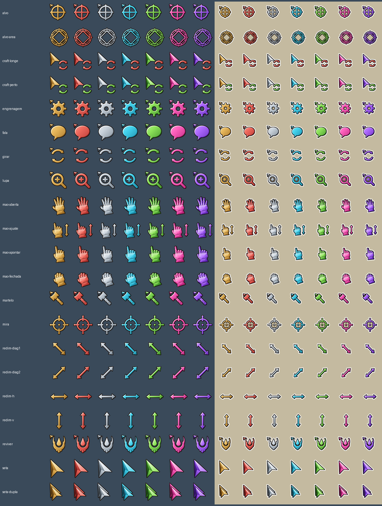
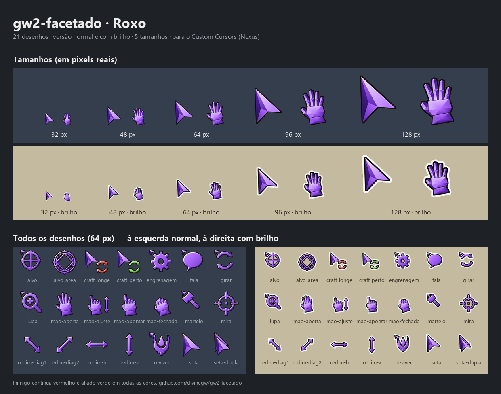
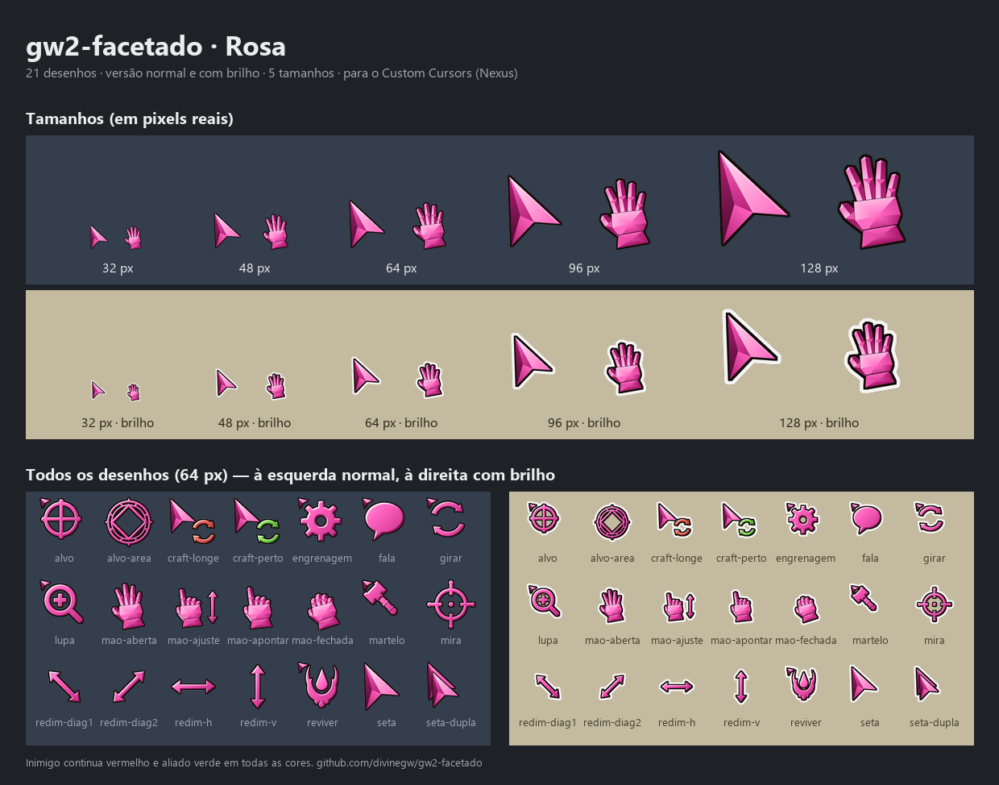

# gw2-facetado

Cursores facetados para **Guild Wars 2**, feitos para o addon **Custom Cursors** do Nexus.
*Faceted cursors for Guild Wars 2, made for the Custom Cursors Nexus addon. [English below](#english).*



- **21 desenhos:** seta, seta dupla, conversar, engrenagem, lupa, martelo, girar, alvo, mira, alvo de área, 4 mãos, 4 setas de redimensionar, reciclar perto/longe e reviver.
- **7 cores:** roxo, ciano, dourado, prata, rosa, verde e vermelho. Todas têm versão normal e versão com **brilho** (borda branca, como o cursor de alto contraste do jogo).
- **5 tamanhos:** 32, 48, 64, 96 e 128 px, cada um com o seu ponto de clique.
- O desenho é original, feito por código no estilo metálico dos cursores do jogo. O pacote não usa arquivos de terceiros.

## Download

Pegue os arquivos na página [**Releases**](../../releases/latest):

| Arquivo | Para quem |
|---|---|
| `gw2-facetado-kit.zip` | Quem usa o **Nexus** com o **Custom Cursors**. Uma pasta por cor, com a prévia daquela cor, um instalador para cada tamanho, o desinstalador e a instalação manual. |
| `gw2-facetado-cur.zip` | **YoloMouse** e outros programas que leem `.cur`. Uma pasta por cor, com a prévia e uma subpasta para cada tamanho. |
| `SHA256.txt` | Os hashes dos ZIPs, para conferir o download. |

<details>
<summary><b>Prévia de cada cor</b> (as mesmas imagens que vão dentro das pastas)</summary>

| | |
|---|---|
|  |  |
|  |  |
|  |  |
|  | |

</details>

## Instalação (Nexus e Custom Cursors)

**Antes de instalar:**
1. Instale o [Nexus](https://raidcore.gg/Nexus).
2. Na biblioteca de addons do Nexus, instale o **Custom Cursors** (jordanrye).
3. Abra o jogo uma vez e feche. Isso cria o `settings.json` do addon.

**O que tem no ZIP:**
```
gw2-facetado-kit\
  Ciano\  Dourado\  Prata\  Rosa\  Roxo\  Verde\  Vermelho\
    previa-verde.png               ← os desenhos daquela cor e os 5 tamanhos
    Instalar Verde 32 px.bat
    Instalar Verde 48 px.bat
    Instalar Verde 64 px.bat
    Instalar Verde 96 px.bat
    Instalar Verde 128 px.bat
    Desinstalar.bat
    manual (sem script)\32 px\settings.json …
  Desinstalar.bat                  ← o mesmo desinstalador, na raiz
  _arquivos\                       ← pacote de imagens e scripts (não precisa abrir)
  previa-todas-as-cores.png, LEIA-ME.txt, README.txt, LICENSE.txt
```

**Com o instalador (recomendado):**
1. Extraia o `gw2-facetado-kit.zip` inteiro.
2. Abra a pasta da cor que você quer e veja a prévia.
3. Com o jogo **fechado**, dê dois cliques em `Instalar <Cor> <tamanho> px.bat`, por exemplo `Instalar Verde 48 px.bat`.
4. Confirme a pasta do jogo e confirme a instalação.

**Qual tamanho?** O padrão é 48 px. Em telas grandes, ou com a interface do jogo ampliada, experimente 64 px. Os de 96 e 128 px são para quem quer o cursor bem grande.

O instalador:
- mostra a lista do que vai mudar antes de aplicar;
- faz backup do `settings.json` (`settings.json.backup-gw2-facetado-<data>`);
- copia o pacote para `addons\CustomCursors\cursors\gw2-facetado`;
- troca **só** os 34 cursores conhecidos, sem mexer nos outros cursores nem nas opções do addon.

Para trocar de cor ou de tamanho, rode outro `Instalar`. Para desfazer, use `Desinstalar.bat`, na raiz ou em qualquer pasta de cor, porque é o mesmo arquivo. Ele volta esses cursores ao padrão do jogo e pergunta se deve apagar a pasta do pacote.

**Sem script (manual):**
1. Copie `_arquivos\gw2-facetado` para `<pasta do jogo>\addons\CustomCursors\cursors\`.
2. Copie `<Cor>\manual (sem script)\<tamanho> px\settings.json` para `<pasta do jogo>\addons\CustomCursors\`. **Atenção:** isso substitui o arquivo inteiro. Se você já tinha cursores configurados no addon, guarde o seu antes.

Os desenhos que o jogo não usa por padrão (seta dupla, martelo, girar, alvo, alvo de área, mão de apontar) também são instalados. Dá para escolhê-los no menu do Custom Cursors, dentro do jogo. Os pontos de clique estão em `_arquivos\gw2-facetado\hotspots.json`.

## YoloMouse (`.cur`)

```
gw2-facetado-cur\
  Verde\                         (e as outras 6 cores)
    previa-verde.png
    32 px\  48 px\  64 px\  96 px\  128 px\   ← os 42 cursores num tamanho só
    todos os tamanhos\                         ← os 42, cada .cur com os 5 tamanhos
```

São 21 desenhos, cada um na versão normal e com `-brilho`. Cada `.cur` já traz o ponto de clique certo. O YoloMouse não tem instalador, porque cada cursor é escolhido dentro do jogo. Copie a pasta do tamanho que quiser (por exemplo, `Verde\48 px`) para a pasta de cursores do YoloMouse e, no jogo, aperte **Ctrl+Alt+C** sobre cada cursor para escolher o desenho. Ainda não foi testado dentro do YoloMouse.

## Onde fica cada coisa

O Custom Cursors fica **dentro da pasta do jogo**, que muda de PC para PC:

| Instalação | Pasta do jogo (exemplo) |
|---|---|
| Instalador da ArenaNet | `C:\Program Files\Guild Wars 2` |
| Steam | `...\steamapps\common\Guild Wars 2` |
| Pasta escolhida por você | por exemplo, `D:\Jogos\Guild Wars 2` |

Em qualquer caso, o pacote vai para `<pasta do jogo>\addons\CustomCursors\cursors\gw2-facetado\`, e a configuração fica em `<pasta do jogo>\addons\CustomCursors\settings.json`.

**Como o instalador acha a pasta do jogo.** Ele procura nesta ordem, só lendo e sem alterar nada:
1. se o ZIP foi extraído dentro da própria pasta do jogo;
2. os atalhos do jogo na área de trabalho, no menu Iniciar e na barra de tarefas;
3. a lista de programas instalados do Windows;
4. os lugares comuns (`Program Files`, `\Games`, `\Guild Wars 2` em cada disco);
5. as bibliotecas da Steam.

Ele sempre mostra a pasta encontrada e pergunta antes de usar. Se não achar nenhuma, abre uma janela para você escolher a pasta que tem o `Gw2-64.exe`.

**Não sabe onde está o jogo?**
- Clique com o botão direito no atalho do Guild Wars 2 e escolha **Abrir local do arquivo**.
- Na Steam: botão direito no jogo → **Gerenciar → Procurar arquivos locais**.
- Dica: extraia o ZIP dentro da pasta do jogo, e o instalador a encontra direto.

**Funciona em qualquer PC:** o `settings.json` guarda caminhos **relativos à pasta do jogo** (`addons/CustomCursors/cursors/gw2-facetado/...`). Por isso, não importa em que disco ou pasta o jogo está instalado.

## Quais cursores mudam

O jogo usa ids diferentes para o mesmo cursor no contraste normal e no contraste alto (com halo). O mapa cobre os dois modos:

| Cursor do jogo | Desenho | Contraste normal | Contraste alto (halo) |
|---|---|---|---|
| Seta padrão / sobre link do chat | seta, na cor escolhida | 2876413485, 2359510116 | 2876413485, 3482162487, 2154574276 |
| Inimigo | seta **vermelha fixa** | 2681826372 | 2681826372, 2692527230 |
| Aliado | seta **verde fixa** | 1391593731 | — |
| Conversar | fala | 204507100 | 2733722094 |
| Interagir (prata e dourada) | engrenagem | 1904910409, 3176363084 | 3611259902, 774285540 |
| Pegar / agarrar / ajustar | mão aberta / fechada / ajuste | 3536603594, 3872050656 / 2147607764 / 161721809 | 3667960659 |
| Reviver | reviver | 3588320565, 4085153991 | 323847572 |
| Mira | mira | 1020886200, 2123062382 | — |
| Zoom | lupa | 1282737976, 3685266938 | — |
| Reciclar perto / longe | craft-perto / craft-longe | 2115911978 / 3060132843 | — |
| Redimensionar ↔ ↕ ⤡ ⤢ | redim-h / v / diag1 / diag2 | 2449019715, 622306980, 2060294237, 1577035093 | 1887523809, 3711244257, 2953070793 |

No contraste alto, os cursores usam a versão **com brilho** da cor. O mapa completo, com uma nota para cada id, está em [`kit/_instalador/mapa.json`](kit/_instalador/mapa.json).

> Os ids do contraste normal vêm da lista *Current Known IDs*, publicada por clollipops no Discord do Raidcore. Os do contraste alto foram anotados no jogo. Se algum cursor não mudar, ou trocar pelo desenho errado, abra uma [issue](../../issues) com o id que aparece no menu do Custom Cursors.

## É seguro?

- **Não há nenhum `.exe`.** Cada `.bat` tem uma linha só, que chama os scripts de [`kit/_instalador`](kit/_instalador). Eles são texto puro e dá para ler antes de rodar.
- Os scripts **não usam internet**, não pedem administrador e só mexem em `addons\CustomCursors\settings.json` (com backup) e na pasta `addons\CustomCursors\cursors\gw2-facetado`.
- O `.bat` usa `-ExecutionPolicy Bypass` porque o Windows bloqueia scripts baixados da internet. A opção vale só para esse script, nessa execução.
- Para conferir o download, compare o resultado com o `SHA256.txt` da release:
  ```
  certutil -hashfile gw2-facetado-kit.zip SHA256
  ```
- Addons são de terceiros. A ArenaNet não revisa nem aprova nenhum, e cada um usa por sua conta ([política](https://help.guildwars2.com/hc/en-us/articles/360013625034-Policy-Third-Party-Programs)). Este pacote só troca a aparência do cursor.

## Avisos

- O Custom Cursors pode mostrar um aviso quando nem todos os cursores do jogo têm arquivo definido ([issue #4 do addon](https://github.com/jordanrye/nexus-custom-cursors/issues/4)). É só um aviso.
- O instalador também grava os cursores que o jogo ainda não mostrou no seu PC. Ainda falta confirmar se o addon usa essas entradas quando o cursor aparece pela primeira vez. Se algum não mudar, rode o `Instalar` de novo depois de ver esse cursor no jogo.
- O pacote para YoloMouse (`.cur`) foi conferido pela API do Windows, mas ainda **não foi testado dentro do YoloMouse**.

## Para quem quer mexer no código

Requer Python 3 com Pillow e NumPy.

| Script | O que faz |
|---|---|
| `scripts/gw2_cursors.py <saida> [--sheet previa.png] [--only tipos]` | Gera os PNGs, o `hotspots.json` e a prévia. |
| `scripts/gw2_cursors_audit_halo.py <pacote> <saida.png>` | Mede a largura da borda de brilho. |
| `scripts/gw2_cursors_to_cur.py <pacote> <saida>` | Converte o pacote em `.cur`, organizado por cor, com uma pasta por tamanho e uma com os `.cur` multitamanho. |
| `scripts/gw2_cursors_check_cur.py <saida>` | Carrega cada `.cur` pela API do Windows e confere o tamanho e o ponto de clique. |
| `scripts/gw2_cursors_build_kit.py <pacote> kit <dist> [--so-previas]` | Monta o kit: pastas por cor, prévias, um `.bat` por tamanho, `settings.json` manuais, ZIPs e hashes. |

## Licença

- **Desenhos** (PNG, `.cur` e a prévia): [CC BY-NC 4.0](https://creativecommons.org/licenses/by-nc/4.0/deed.pt-br). Você pode usar, modificar e redistribuir, desde que dê crédito e não venda.
- **Scripts** (`scripts/` e `kit/_instalador/`): MIT.

O texto completo está em [LICENSE](LICENSE).

Não é afiliado à ArenaNet, à NCSOFT nem ao autor do Custom Cursors. Guild Wars 2 é marca da ArenaNet/NCSOFT.

---

## English

Faceted cursors for **Guild Wars 2**, made for the **Custom Cursors** Nexus addon.
- 21 drawings in 7 colours (*roxo* purple, *ciano* cyan, *dourado* gold, *prata* silver, *rosa* pink, *verde* green, *vermelho* red).
- Each drawing comes plain and with **glow** (*brilho*, a white outline like the game's high-contrast cursor).
- 5 sizes (32 to 128 px).
- Original artwork, generated by code. No third-party files.

**Download** from [Releases](../../releases/latest):
- `gw2-facetado-kit.zip`: for Nexus + Custom Cursors. One folder per colour with a preview, one installer per size, an uninstaller and ready-made `settings.json` files.
- `gw2-facetado-cur.zip`: `.cur` files for YoloMouse and similar tools. One folder per colour with a preview and one subfolder per size; `todos os tamanhos` holds files that contain all 5 sizes.

**Install:**
1. Install [Nexus](https://raidcore.gg/Nexus) and the **Custom Cursors** addon from its library.
2. Start the game once, then close it.
3. Extract the ZIP and open the folder of the colour you want.
4. With the game **closed**, double-click `Instalar <Colour> <size> px.bat`, for example `Instalar Verde 48 px.bat` (*Instalar* = install). 48 px is the default; try 64 px on large screens.

The installer:
- shows what will change before applying it;
- backs up `settings.json`;
- changes only the 34 known cursor ids, covering both normal and high-contrast modes. The enemy arrow stays red and the ally arrow green.

Custom Cursors lives **inside your game folder**: `<game folder>\addons\CustomCursors\`. The game folder differs per PC; it is the one with `Gw2-64.exe`. The installer looks for it, read-only, in this order:
1. the folder the ZIP was extracted into;
2. game shortcuts on the desktop, Start menu and taskbar;
3. the Windows installed-programs list;
4. common locations;
5. Steam libraries.

It always asks before using a folder, and opens a folder picker if nothing is found. Paths saved in `settings.json` are relative to the game folder, so it works wherever the game is installed.

`Desinstalar.bat` (*uninstall*, at the top level or in any colour folder) resets those cursors. To install without running a script, copy `_arquivos\gw2-facetado` and `<Colour>\manual (sem script)\<size> px\settings.json`; this replaces your whole `settings.json`.

**YoloMouse:** there is no installer, since YoloMouse picks each cursor in game. Copy a size folder (e.g. `Verde\48 px`) into YoloMouse's cursor folder and press **Ctrl+Alt+C** over each cursor in game. Not yet tested inside YoloMouse.

**Safety:**
- There is no `.exe`. Each `.bat` is a single line, and the PowerShell scripts in [`kit/_instalador`](kit/_instalador) are plain text you can read first.
- The scripts make no network access and need no admin rights. They only touch `addons\CustomCursors\settings.json` (backed up) and the pack folder.
- Check the ZIP against `SHA256.txt`.

Normal-contrast ids come from the *Current Known IDs* list by clollipops on the Raidcore Discord. If a cursor doesn't change or shows the wrong drawing, please open an [issue](../../issues) with the id shown in the Custom Cursors menu.

**License:**
- Artwork: [CC BY-NC 4.0](https://creativecommons.org/licenses/by-nc/4.0/). Share and modify with credit, no commercial use.
- Scripts: MIT.
- Full text in [LICENSE](LICENSE).

Not affiliated with ArenaNet, NCSOFT or the author of Custom Cursors.
