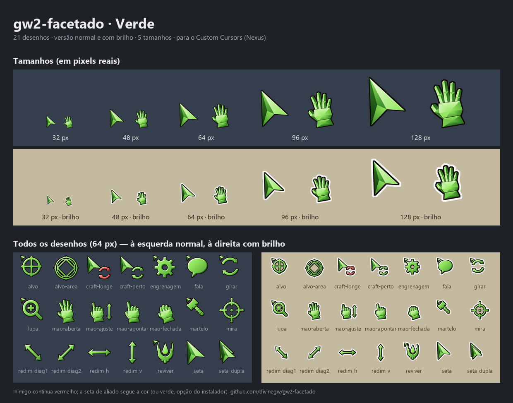
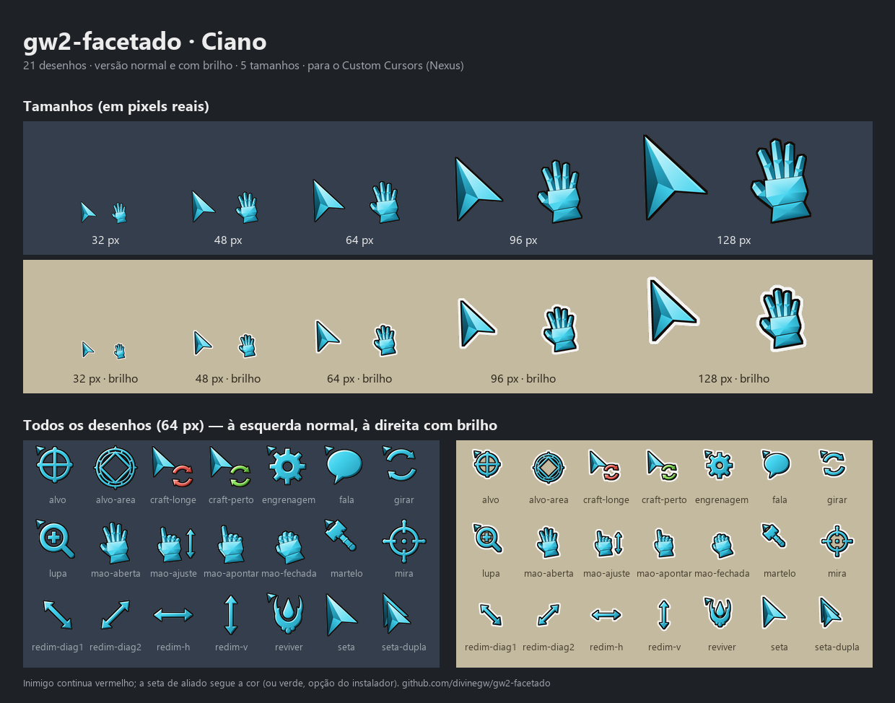
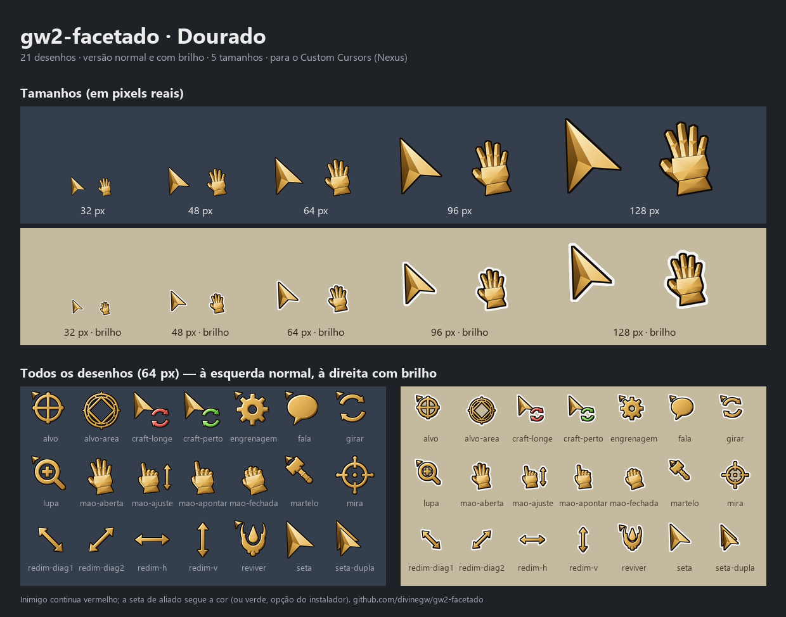
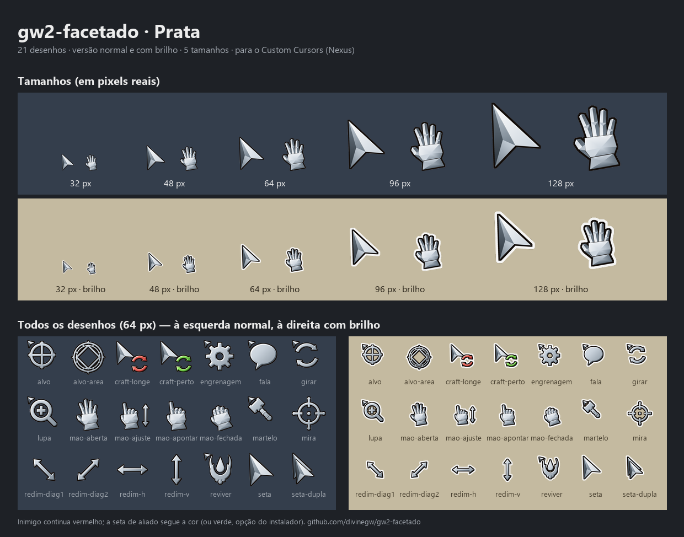
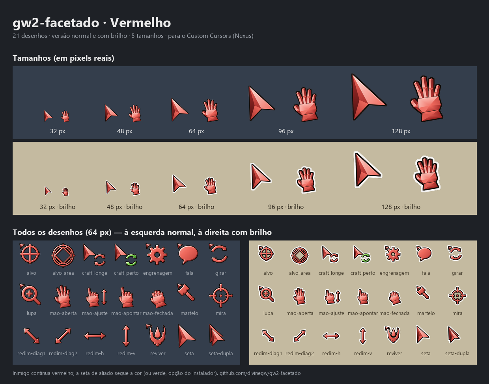
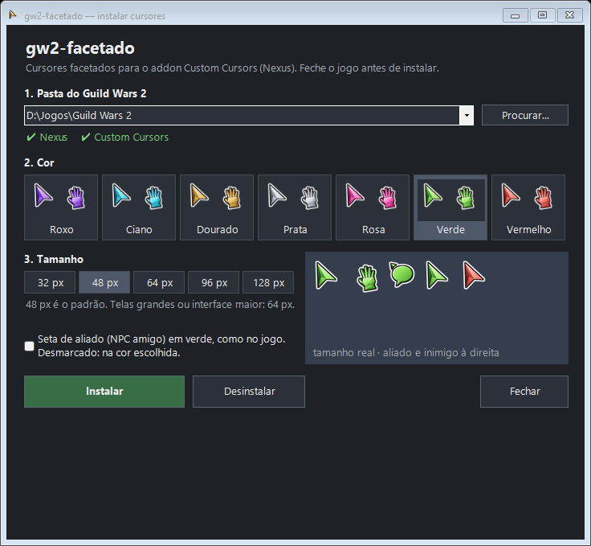

# gw2-facetado

Cursores facetados para **Guild Wars 2**, feitos para o addon **Custom Cursors** do Nexus.
*Faceted cursors for Guild Wars 2, made for the Custom Cursors Nexus addon. [English below](#english).*


- **21 desenhos:** seta, seta dupla, conversar, engrenagem, lupa, martelo, girar, alvo, mira, alvo de área, 4 mãos, 4 setas de redimensionar, reciclar (pode / não pode) e reviver.
- **7 cores:** roxo, ciano, dourado, prata, rosa, verde e vermelho. Todas têm versão normal e versão com **brilho** (borda branca, como o cursor de contraste do jogo).
- **5 tamanhos:** 32, 48, 64, 96 e 128 px, cada um com o seu ponto de clique.
- Funciona nos **três modos de contraste do cursor** do jogo, com o mesmo tamanho na tela em todos.
- O desenho é original, feito por código no estilo metálico dos cursores do jogo. O pacote não usa arquivos de terceiros.

## Download

Pegue os arquivos na página [**Releases**](../../releases/latest):

| Arquivo | Para quem |
|---|---|
| `gw2-facetado-kit.zip` | Quem usa o **Nexus** com o **Custom Cursors**. Um instalador com janela: escolhe a cor e o tamanho e instala. |
| `gw2-facetado-cur.zip` | **YoloMouse** e outros programas que leem `.cur`. Uma pasta por cor, com a prévia e uma subpasta para cada tamanho. |
| `SHA256.txt` | Os hashes dos ZIPs, para conferir o download. |

<details>
<summary><b>Prévia de cada cor</b></summary>

| | |
|---|---|
|  |  |
|  |  |
|  |  |
|  | |

</details>

## Instalação (Nexus e Custom Cursors)

1. Tenha o [Nexus](https://raidcore.gg/Nexus) e o addon **Custom Cursors** (no jogo: `Ctrl+O` → Addons → Library → Custom Cursors → Install).
2. Extraia o `gw2-facetado-kit.zip` inteiro (botão direito → **Extrair tudo**) e feche o jogo.
3. Dê dois cliques em **`Instalar.bat`**, escolha a cor e o tamanho e clique em **Instalar**.



A janela:
- acha a pasta do jogo sozinha e mostra se o Nexus e o Custom Cursors estão instalados e se o jogo está aberto;
- mostra a prévia em tamanho real da cor e do tamanho escolhidos;
- tem a opção de deixar a **seta de aliado** (a que aparece sobre NPCs amigos) em verde, como no jogo; desmarcada, ela fica na cor escolhida;
- faz backup do `settings.json` (`settings.json.backup-gw2-facetado-<data>`) e, se o addon ainda não tiver um, cria;
- copia o pacote para `addons\CustomCursors\cursors\gw2-facetado` e troca **só** os cursores conhecidos, sem mexer nos outros nem nas opções do addon;
- tem o botão **Desinstalar**, que volta esses cursores ao padrão do jogo.

Para trocar de cor ou de tamanho, abra o `Instalar.bat` de novo. Não precisa desinstalar antes.

**Qual tamanho?** O padrão é 48 px. Em telas grandes, ou com a interface do jogo ampliada, experimente 64 px. Os de 96 e 128 px são para quem quer o cursor bem grande.

**O que tem no ZIP:**
```
gw2-facetado-kit\
  Instalar.bat                  ← abre a janela do instalador
  Desinstalar.bat               ← desinstala sem abrir a janela
  previa-todas-as-cores.png, LEIA-ME.txt, README.txt, LICENSE.txt
  _arquivos\                    ← pacote de imagens, scripts, prévias e instalação manual
```

**Sem script (manual):**
1. Copie `_arquivos\gw2-facetado` para `<pasta do jogo>\addons\CustomCursors\cursors\`.
2. Copie `_arquivos\manual (sem script)\<Cor>\<tamanho> px\settings.json` para `<pasta do jogo>\addons\CustomCursors\`. **Atenção:** isso substitui o arquivo inteiro. Se você já tinha cursores configurados no addon, guarde o seu antes.

## Contraste do cursor

O jogo tem três modos em **Opções → Geral → Acessibilidade → Contraste do cursor**, e cada um usa cursores diferentes:

| Modo | Cursor do jogo | O que o pacote usa |
|---|---|---|
| Desligar | 32 px, sem halo | desenho normal, a 80% do tamanho escolhido |
| Baixo | 64 px, com halo | desenho com brilho, no tamanho escolhido |
| Alto | 128 px, com anel | desenho com brilho, no tamanho escolhido |

O desenho com brilho ocupa uns 80% do quadro (o resto é a borda branca). Por isso o desenho normal do modo Desligar é reduzido para 80%: assim o cursor tem o mesmo tamanho na tela nos três modos. O addon redimensiona o PNG, mas não o ponto de clique; o instalador ajusta o ponto de clique também.

> **Modo Alto:** por enquanto só a seta padrão desse modo foi identificada. Os outros cursores aparecem no padrão do jogo. Se você joga no modo Alto, abra uma [issue](../../issues).

## Quais cursores mudam

O Custom Cursors identifica cada cursor por um id, que é um hash da imagem do cursor do jogo. São 49 ids:

| Cursor do jogo | Desenho | Desligar | Baixo | Alto |
|---|---|---|---|---|
| Seta padrão / sobre link do chat | seta | 2876413485, 2359510116 | 3482162487, 2154574276 | 180141693 |
| Inimigo | seta **vermelha fixa** | 2681826372 | 2692527230 | — |
| Aliado (NPC amigo) | seta, na cor ou verde | 1391593731 | 3067464994 | — |
| Conversar | fala | 204507100 | 2733722094 | — |
| Interagir (prata e dourada) | engrenagem | 1904910409, 3176363084 | 3611259902, 774285540 | — |
| Pegar | mão aberta | 3536603594, 3872050656 | 3667960659, 197794381, 199871974 | — |
| Agarrar / ajustar | mão fechada / ajuste | 2147607764 / 161721809 | — / 2748539150 | — |
| Reviver | reviver | 3588320565, 4085153991 | 323847572, 3319337567 | — |
| Mira | mira | 1020886200, 2123062382 | 1150024876 | — |
| Inspecionar | lupa | 1282737976, 3685266938 | 1012485662, 4091533056 | — |
| Kit de reciclagem: pode / não pode | craft-perto / craft-longe | 2115911978 / 3060132843 | 3926064249 / 3071360303 | — |
| Redimensionar ↔ | redim-h | 2449019715, 1887523809 | 611207192 | — |
| Redimensionar ↕ | redim-v | 622306980, 3711244257 | 2121197186 | — |
| Redimensionar ⤡ / ⤢ | redim-diag1 / diag2 | 2060294237, 2953070793 / 1577035093 | 3568600054 / 1431119650 | — |

O mapa completo, com uma nota para cada id, está em [`kit/_instalador/mapa.json`](kit/_instalador/mapa.json).

**Extras:** os desenhos que o jogo não usa (seta dupla, martelo, girar, alvo, alvo de área, mão de apontar) também são instalados, e dá para escolhê-los no menu do Custom Cursors, dentro do jogo. O jogo não tem cursor de martelo: o kit de reciclagem, inclusive os infinitos, usa a seta com setas circulares (craft-perto / craft-longe).

> **De onde vêm os ids:** os do modo Desligar vêm da lista *Current Known IDs*, publicada por clollipops no Discord do Raidcore. Os dos modos Baixo e Alto foram tirados do cache do próprio addon (`addons\CustomCursors\appcache\previews.json`), que guarda a imagem original de cada cursor que o jogo mostrou. Se algum cursor não mudar ou trocar pelo desenho errado, abra uma [issue](../../issues) dizendo em que modo de contraste aconteceu.

## YoloMouse (`.cur`)

```
gw2-facetado-cur\
  Verde\                         (e as outras 6 cores)
    previa-verde.png
    32 px\  48 px\  64 px\  96 px\  128 px\   ← os 42 cursores num tamanho só
    todos os tamanhos\                         ← os 42, cada .cur com os 5 tamanhos
```

São 21 desenhos, cada um na versão normal e com `-brilho`. Cada `.cur` já traz o ponto de clique certo. O YoloMouse não tem instalador, porque cada cursor é escolhido dentro do jogo. Copie a pasta do tamanho que quiser (por exemplo, `Verde\48 px`) para a pasta de cursores do YoloMouse e, no jogo, aperte **Ctrl+Alt+C** sobre cada cursor para escolher o desenho. Ainda não foi testado dentro do YoloMouse.

## Onde fica cada coisa

O Custom Cursors fica **dentro da pasta do jogo** (a que tem o `Gw2-64.exe`), que muda de PC para PC:

| Instalação | Pasta do jogo (exemplo) |
|---|---|
| Instalador da ArenaNet | `C:\Program Files\Guild Wars 2` |
| Steam | `...\steamapps\common\Guild Wars 2` |
| Pasta escolhida por você | por exemplo, `D:\Jogos\Guild Wars 2` |

O pacote vai para `<pasta do jogo>\addons\CustomCursors\cursors\gw2-facetado\`, e a configuração fica em `<pasta do jogo>\addons\CustomCursors\settings.json`.

**Como o instalador acha a pasta do jogo.** Ele procura nesta ordem, só lendo e sem alterar nada:
1. se o ZIP foi extraído dentro da própria pasta do jogo;
2. o jogo aberto no momento;
3. os atalhos do jogo na área de trabalho, no menu Iniciar e na barra de tarefas;
4. a lista de programas instalados do Windows;
5. os lugares comuns (`Program Files`, `\Games`, `\Guild Wars 2` em cada disco);
6. as bibliotecas da Steam.

Se não achar, use o botão **Procurar...** da janela. Não sabe onde está o jogo? Botão direito no atalho do Guild Wars 2 → **Abrir local do arquivo**. Na Steam: botão direito no jogo → **Gerenciar → Procurar arquivos locais**.

**Funciona em qualquer PC:** o `settings.json` guarda caminhos **relativos à pasta do jogo** (`addons/CustomCursors/cursors/gw2-facetado/...`).

## É seguro?

- **Não há nenhum `.exe`.** Os `.bat` chamam os scripts PowerShell de [`kit/_instalador`](kit/_instalador). Eles são texto puro e dá para ler antes de rodar.
- Os scripts **não usam internet**, não pedem administrador e só mexem em `addons\CustomCursors\settings.json` (com backup) e na pasta `addons\CustomCursors\cursors\gw2-facetado`.
- O `.bat` usa `-ExecutionPolicy Bypass` porque o Windows bloqueia scripts baixados da internet. A opção vale só para esse script, nessa execução.
- Para conferir o download, compare o resultado com o `SHA256.txt` da release:
  ```
  certutil -hashfile gw2-facetado-kit.zip SHA256
  ```
- Addons são de terceiros. A ArenaNet não revisa nem aprova nenhum, e cada um usa por sua conta ([política](https://help.guildwars2.com/hc/en-us/articles/360013625034-Policy-Third-Party-Programs)). Este pacote só troca a aparência do cursor.

## Avisos

- O Custom Cursors pode mostrar um aviso no log quando nem todos os cursores do jogo têm arquivo definido ([issue #4 do addon](https://github.com/jordanrye/nexus-custom-cursors/issues/4)). É só um aviso.
- O pacote para YoloMouse (`.cur`) foi conferido pela API do Windows, mas ainda **não foi testado dentro do YoloMouse**.

## Para quem quer mexer no código

Requer Python 3 com Pillow e NumPy.

| Script | O que faz |
|---|---|
| `scripts/gw2_cursors.py <saida> [--sheet previa.png] [--only tipos]` | Gera os PNGs, o `hotspots.json` e a prévia. |
| `scripts/gw2_cursors_audit_halo.py <pacote> <saida.png>` | Mede a largura da borda de brilho. |
| `scripts/gw2_cursors_to_cur.py <pacote> <saida>` | Converte o pacote em `.cur`, organizado por cor, com uma pasta por tamanho e uma com os `.cur` multitamanho. |
| `scripts/gw2_cursors_check_cur.py <saida>` | Carrega cada `.cur` pela API do Windows e confere o tamanho e o ponto de clique. |
| `scripts/gw2_cursors_build_kit.py <pacote> kit <dist> [--so-previas]` | Monta o kit: instalador, prévias por cor, `settings.json` manuais, ZIPs e hashes. |

O instalador fica em `kit/_instalador`: `janela.ps1` (a janela), `comum.ps1` (instalar e desinstalar), `instalar.ps1` e `desinstalar.ps1` (linha de comando) e `mapa.json` (id → desenho e modo de contraste).

## Licença

- **Desenhos** (PNG, `.cur` e a prévia): [CC BY-NC 4.0](https://creativecommons.org/licenses/by-nc/4.0/deed.pt-br). Você pode usar, modificar e redistribuir, desde que dê crédito e não venda.
- **Scripts** (`scripts/` e `kit/_instalador/`): MIT.

O texto completo está em [LICENSE](LICENSE).

Não é afiliado à ArenaNet, à NCSOFT nem ao autor do Custom Cursors. Guild Wars 2 é marca da ArenaNet/NCSOFT.

---

## English

Faceted cursors for **Guild Wars 2**, made for the **Custom Cursors** Nexus addon.
- 21 drawings in 7 colours (*roxo* purple, *ciano* cyan, *dourado* gold, *prata* silver, *rosa* pink, *verde* green, *vermelho* red).
- Each drawing comes plain and with **glow** (*brilho*, a white outline like the game's contrast cursors).
- 5 sizes (32 to 128 px).
- Works in all three of the game's **cursor contrast** modes, at the same on-screen size.
- Original artwork, generated by code. No third-party files.

**Download** from [Releases](../../releases/latest):
- `gw2-facetado-kit.zip`: for Nexus + Custom Cursors, with an installer window.
- `gw2-facetado-cur.zip`: `.cur` files for YoloMouse and similar tools. One folder per colour with a preview and one subfolder per size; `todos os tamanhos` holds files that contain all 5 sizes.

**Install:**
1. Install [Nexus](https://raidcore.gg/Nexus) and the **Custom Cursors** addon (in game: `Ctrl+O` → Addons → Library).
2. Extract the whole ZIP and close the game.
3. Double-click **`Instalar.bat`** (*install*), pick a colour and a size, and click **Install**. 48 px is the default; try 64 px on large screens.

The window finds the game folder on its own, shows whether Nexus and Custom Cursors are there, previews the cursor at actual size, and has an option to keep the **ally arrow** (shown over friendly NPCs) green instead of the chosen colour. It backs up `settings.json` (or creates one if the addon has none yet) and changes only the 49 known cursor ids. The enemy arrow stays red. Run it again to switch colour or size; the **Uninstall** button resets the cursors.

**Cursor contrast** (Options → General → Accessibility): the game uses different cursors in Off (32 px, no halo), Low (64 px, halo) and High (128 px, ring) modes. The installer covers all three and draws the Off-mode cursors at 80% of the chosen size, so the cursor looks the same size in every mode. In High mode only the default arrow has been identified so far.

The game has no hammer cursor: salvage kits use the arrow with circular arrows. The hammer and other unused drawings are installed as extras you can pick in the Custom Cursors menu.

To install without running a script, copy `_arquivos\gw2-facetado` and `_arquivos\manual (sem script)\<Colour>\<size> px\settings.json`; this replaces your whole `settings.json`.

**Safety:**
- There is no `.exe`. The `.bat` files run the plain-text PowerShell scripts in [`kit/_instalador`](kit/_instalador).
- The scripts make no network access and need no admin rights. They only touch `addons\CustomCursors\settings.json` (backed up) and the pack folder.
- Check the ZIP against `SHA256.txt`.

If a cursor doesn't change or shows the wrong drawing, please open an [issue](../../issues) and say which contrast mode you were using.

**License:**
- Artwork: [CC BY-NC 4.0](https://creativecommons.org/licenses/by-nc/4.0/). Share and modify with credit, no commercial use.
- Scripts: MIT.
- Full text in [LICENSE](LICENSE).

Not affiliated with ArenaNet, NCSOFT or the author of Custom Cursors.
